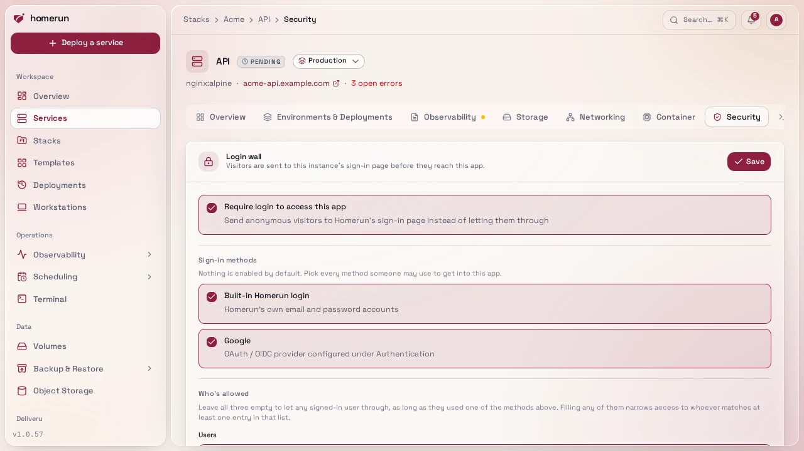
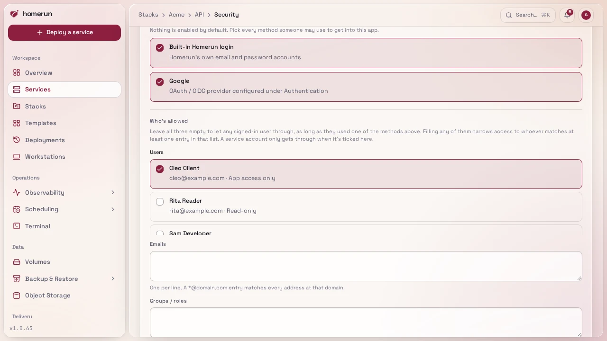
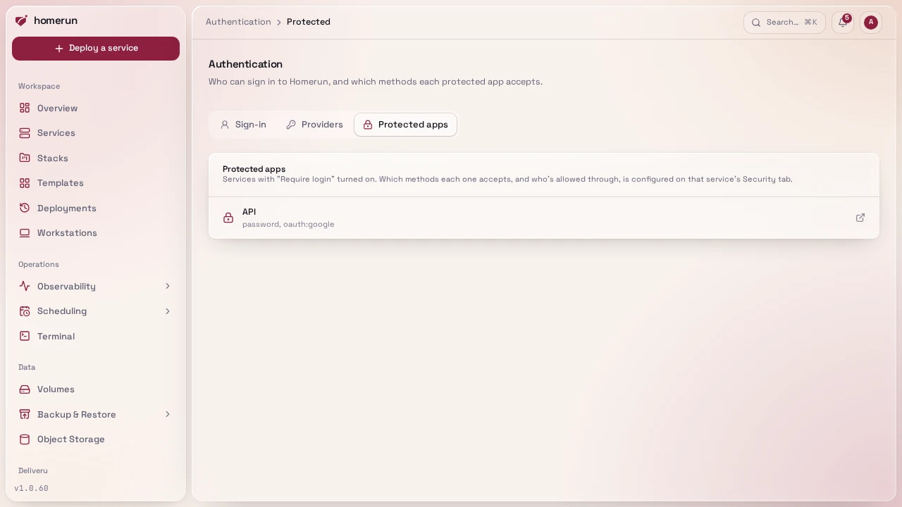

# Per-app login wall

A deployed service can require a login before anyone reaches it. Turn on
**Require login to access this app** on the service's **Security** tab, under
Login wall, or in the deploy wizard's Networking step. Turning it on in the
wizard enables the built-in Homerun login as the sign-in method; add OAuth
providers or an allow-list on the Security tab afterwards.



**How it works.** Traefik's forwardAuth middleware asks Homerun about every
request to that hostname. A visitor without a valid session for that app is
redirected to Homerun's own sign-in page, the same one as the dashboard's, so
passkeys, two-factor codes and your preferred sign-in methods all work there.
The page names the app they're signing in to and wears the brand set under
[Settings → Error pages](error-pages.md#branding-and-text) (name, logo and
accent colour), and once they're in it shows a short "taking you to …" screen
before sending them back to the page they originally asked for. Homerun then
sets a session cookie scoped to that app's own hostname, so the app stays
reachable for eight hours without signing in again. Nothing is shared with your
other apps: each one gets its own cookie, and a cookie issued for one hostname
is rejected on any other.

Only page loads are redirected. A request the app's own page makes in the
background (a `fetch`, a script, an image) without a session gets a plain 401,
since it can't follow a redirect to a sign-in page on another address anyway.
The app's web app manifest (`manifest.json`, `manifest.webmanifest` or
`site.webmanifest`) is let through without a session: browsers never send
cookies when they fetch it, and it only holds the app's name, icons and colors.

This needs the **Dashboard URL** set under Settings → General, since that's the
URL visitors are sent to in order to sign in. Saving the setting is refused with
an explanation if it isn't set yet. It does **not** need **Cross-subdomain
cookies** (Settings → General), which is unrelated to this flow.

**Sign-in methods.** Nothing is enabled by default: pick at least one of the
built-in login, **Emailed code**, **Emailed link** and your configured OAuth
providers. The two emailed methods are listed once they're switched on under
Authentication (see
[Emailed codes and links](authentication-providers.md#emailed-codes-and-links)).
Only an account linked to one of the methods you pick is let through; someone
who signs in another way sees a "you don't have access" screen with a button to
sign in as someone else. Every account has an email address, so allowing an
emailed method lets any account through on that count; narrow it with the lists
below. An emailed method that's later switched off, or loses SMTP, stops
counting until it's back. Turning the wall on with nothing picked is refused, so
you can't lock yourself out by accident.

**Who's allowed.** Three optional lists narrow access further:

- **Users** — specific Homerun accounts.
- **Emails** — exact addresses, or `*@example.com` to cover a whole domain.
- **Groups / roles** — matched against the group and role claims in the id token
  your OAuth provider issued (`groups`, `roles`, and Keycloak's realm and
  resource roles). Make sure the provider's scopes actually request them, often
  by adding a `groups` scope.

Leave all three empty to let any signed-in user through, as long as they used an
allowed method. Filling any of them narrows access to whoever matches at least
one entry in that list. Changing any of this takes effect immediately, including
for people already signed in to that app.



Every service with its wall on is listed under **Authentication → Protected
apps**, with the sign-in methods it accepts.



**Turning the wall on or off redeploys the service**, which Homerun starts for
you when you save (on swarm that's a rolling update, so the app stays up). Only
a service with its wall on sends each request to Homerun for a check: a public
service is served by Traefik directly, costs Homerun nothing per request, and
keeps working while Homerun itself is down. Changing who's allowed, with the
wall already on, still applies immediately.

**Covering only some paths.** Under **Login wall paths** on the Security tab,
**Covers** picks **Every path** (the default), **Only these paths** (say
`/admin`, leaving the rest of the site public) or **Every path except these**
(say `/api` and `/health`, for a public API or a health check behind an
otherwise private app). Patterns use the same syntax as
[blocked paths](blocked-paths-and-ip-bans.md#blocked-paths): one per line,
matching whole path segments anywhere, `/` at the start to match from the root,
`*` for anything. The wall's own sign-in callback always stays behind it. Like
turning the wall on, saving a change redeploys a running service. Pull request
previews keep their own wall on every path.

The app itself receives the signed-in identity as `X-Homerun-User`,
`X-Homerun-Email` and `X-Homerun-Name` request headers, which an app that
supports proxy-header authentication can consume directly.

**Groups include the Homerun role.** Besides the provider's claims, a user's
Homerun role (`admin`, `developer`, `viewer` for read-only, `custom`, or
`app-user` for app access only) counts as a group, so an app can be limited to
`admin` without an identity provider at all.

**Sharing an app with someone who shouldn't see the dashboard.** Create them on
`/users` with the **App access only** role, then pick them under **Users** on
the app's Security tab (every account is listed there, with its role). Allow
**Emailed code** on the app too if they shouldn't need a password: they then
sign in with a code sent to their address. They sign in through the wall like
anyone else, but Homerun itself refuses them everywhere else, and opening the
dashboard shows them only the list of apps they're allowed into. See
[Users and roles](users-and-roles.md). Note that a wall with all three lists
empty lets **any** signed-in account through, app-access accounts included.

**Letting CI through: service accounts.** A CI job running end-to-end tests
against an app or a pull request preview behind the wall shouldn't borrow a
person's API key, whose permissions cover the whole instance. Create a **service
account** under Administration → **Service accounts** instead (or
`homerun service-accounts create`, the REST API, or the Terraform
`homerun_service_account` resource), mint it an API key on its **API keys** tab
(`homerun service-accounts keys create <id>`, shown once), and tick it under
**Users** on the app's Security tab or the Previews access policy, or put its id
in `auth_allowed_user_ids` / `preview_auth_allowed_user_ids`.

A service account has no sign-in method at all: no password, no emailed code or
link, no passkey, no OAuth. It can never open a dashboard session, and no code
or link is ever mailed to it. Its API key is its only credential, and it stands
in for the sign-in method: the account is let through a wall **only when that
wall lists it under Users**, whatever its methods, emails and groups say. By
default its key reaches nothing else, neither the dashboard nor the REST API; an
admin can grant it permission areas on its Settings tab, as for a custom role.

In CI, trade the key for the app's session cookie with the CLI:

```sh
export HOMERUN_BASE_URL=https://homerun.example.com
export HOMERUN_API_KEY=<the service account's key>
homerun gate session https://pr-42.app.example.com                # prints homerun_app_session=…
homerun gate session https://pr-42.app.example.com --playwright state.json
```

The first prints a `Cookie` header value; `--playwright` writes a Playwright
`storageState` file to load into the browser context instead. The handshake
follows no redirect automatically: the key is only ever sent to the Homerun
dashboard's own address, after checking the wall really redirected there, never
to the app's host. The cookie lasts eight hours, like a person's.

**Disable** a service account on its Settings tab to refuse its keys right away
without deleting it; cookies it already holds stop working within five minutes.
Every use of its keys, through a wall or the API and refused ones included, is
recorded under its **Activity** tab and in Service accounts → **Activity**, with
the account's name, the outcome and the caller's address, and stays there after
the account is deleted. Service accounts don't apply when Pangolin owns the
login (the wall is then Pangolin's, not Homerun's).

**Revocation.** Access is re-checked when the app cookie is issued, whenever the
rules change, and again at least every five minutes while the cookie is in use.
Deleting, banning or re-roling a user in Homerun, or unlinking one of their
sign-in methods, is picked up on their next request to any gated app. For an app
that filters on groups, the five-minute re-check first asks the user's OAuth
provider for fresh tokens, so a group removed at the provider is noticed within
about five minutes, as long as the provider issues refresh tokens and returns a
new id token on refresh, which usually needs the `offline_access` scope. If the
refresh fails, the groups from the last sign-in are used until the eight-hour
cookie lifetime runs out.

**Limits worth knowing.** The wall covers services Traefik routes publicly; a
service that isn't publicly routed has no router to gate.
