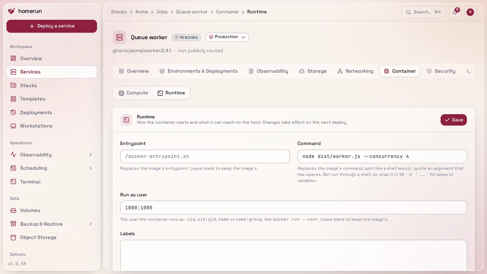
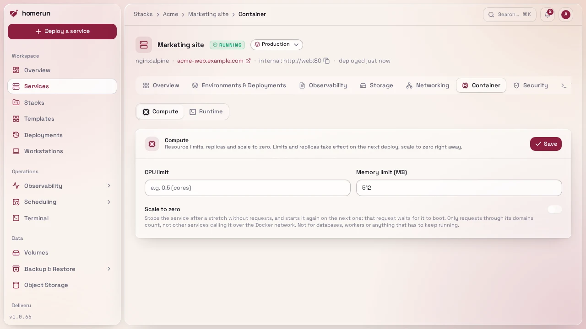

# Runtime and compute

Advanced mode: [simple mode](ui-modes.md) hides the Runtime section of a
service's Container tab. Everything here keeps working either way, and a hidden
page still opens from a link.

How a service's container starts, what it can reach on the host, and how much
CPU and memory it gets.

## Runtime

**Container → Runtime** changes how the container starts and what it can reach
on the host, all applied on the next deploy:

- **Entrypoint** and **Command** replace the image's own, split the way a shell
  would (quote an argument with spaces). They aren't run through a shell: use
  `sh -c '...'` for pipes or variables. Leave blank to keep the image's.
- **Labels**, one `KEY=VALUE` per line, added to the container (and to the swarm
  service in swarm mode). Homerun's own tracking and Traefik labels win on a
  clash, so a custom label can add a Traefik middleware but can't break the
  service's route.
- **Run as user**, the user the container runs as instead of the image's: `uid`,
  `uid:gid`, `name` or `name:group`, like `docker run --user`. Blank keeps the
  image's. Useful when a fresh named volume comes up root-owned and the image's
  own non-root user can't write to it: run it as `0`. Applies in swarm mode too.
- **Added capabilities** (`NET_ADMIN, SYS_TIME`), **Devices**
  (`host[:container[:rwm]]`, like `docker run --device`) and **Run privileged**.
  Only an account with write access to System can set or change these three
  (admins, or a custom role you give it to): they give the container access to
  the host, so other roles see them read-only, and the REST API and compose
  import refuse them with a 403. The same goes for deploying a template that
  sets them. Swarm services can't run privileged or map devices, so those two
  are ignored in [swarm mode](swarm-mode.md); capabilities, labels, command,
  entrypoint and the run-as user apply there too.

## Compute

CPU and memory limits under **Container → Compute**, applied as real Docker
resource limits on the next deploy. The same section carries the replica count
used by [swarm mode](swarm-mode.md); it has no effect in standalone mode, where
a service is always one container.

## Scale to zero

**Container → Compute → Scale to zero** stops a service after a number of
minutes without a request (1 to 1440), and starts it again when the next one
arrives. Unlike the limits above, it applies as soon as you save. A sleeping
service shows as stopped, and the Compute tab says when it went to sleep.

What counts as a request: one that reaches the service through Traefik, on one
of its domains, as recorded for its [Monitoring](observability.md). Another
service calling it over the Docker network doesn't count and doesn't wake it, so
don't use it for anything other services call internally, nor for a database, a
queue worker or anything else that has to keep running. Bots scanning your
domains wake it too.

The request that finds it asleep waits while it starts, up to 25 seconds, then
is sent back to the same address (a `307`, so a `POST` keeps its body) and
reaches the app. If it takes longer, it gets the **Waking up**
[error page](error-pages.md), a `503` with `Retry-After: 2` that a browser
reloads on its own until the app is up. The wait is how long the service takes
to start and pass its healthcheck: a few hundred milliseconds of Docker plus
however long the app needs to boot. Homerun does nothing to make the app itself
start faster.

It needs the error pages to be published (Traefik's dynamic config directory set
in Settings → Networking): the catch-all router is what catches the request for
a sleeping service. Until they are, or for a service with public routing off or
host networking, nothing is put to sleep. Its uptime probe through its address
is skipped too, since the probe is itself a request and would keep it awake.

Starting or deploying the service by hand wakes it, and stopping it by hand ends
the sleep: it then stays stopped until you start it. Turning scale to zero off
while it sleeps starts it. In swarm mode it scales to 0 replicas and back.
